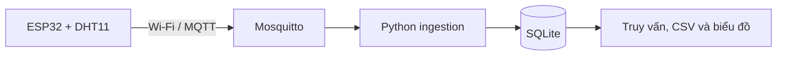

# CSE3069 – Thực hành 05

Thu thập nhiệt độ, độ ẩm từ ESP32 + DHT11, gửi qua MQTT và lưu vào SQLite để truy vấn, vẽ biểu đồ.

## Sơ đồ hệ thống



## Đấu nối

Tắt nguồn trước khi đấu dây.

| DHT11 | ESP32 |
|---|---|
| VCC | 3V3 |
| DATA | GPIO4 |
| GND | GND |

Nếu dùng cảm biến rời, nối điện trở kéo lên 4.7–10 kΩ giữa DATA và VCC. Module thường có sẵn điện trở.

## Cách chạy

Cần Python 3.10, Mosquitto và VS Code có PlatformIO. Chạy các lệnh dưới đây từ thư mục gốc dự án.

### 1. Nạp firmware

Sao chép `firmware/include/secrets.example.h` thành `secrets.h`, nhập Wi-Fi 2.4 GHz và mật khẩu. Đổi địa chỉ broker trong `app_config.h` thành IPv4 LAN của laptop.

```powershell
pio run -d firmware -j 1 --target upload --upload-port COM13
pio device monitor --port COM13 --baud 115200
```

Thay `COM13` bằng cổng của ESP32. Không đưa `secrets.h` lên GitHub.

### 2. Chạy broker

```powershell
mosquitto -c .\broker\mosquitto.conf -v
```

Nếu broker đã chạy trên cổng 1883 thì dùng tiến trình hiện có. Cấu hình anonymous chỉ dành cho mạng lab tin cậy.

### 3. Nhận và lưu dữ liệu

Mở terminal khác:

```powershell
python -m venv .venv
.\.venv\Scripts\python.exe -m pip install -r requirements.txt
.\.venv\Scripts\python.exe .\ingest\ingest_service.py
```

Dữ liệu được lưu tại `data/greenhouse.db`. Topic MQTT là `cse3069/th05/esp32/telemetry`, QoS 1, retain false.

Service kiểm tra dữ liệu, giữ NULL khi cảm biến lỗi và chống trùng theo `device_id + boot_id + seq`. SQLite dùng WAL và synchronous FULL.

### 4. Truy vấn và vẽ biểu đồ

```powershell
.\.venv\Scripts\python.exe .\analysis\query_timerange.py --last-hours 1
.\.venv\Scripts\python.exe .\analysis\plot_data.py --last-hours 1
```

Ảnh và CSV được lưu trong `results/`. Xem [hướng dẫn phân tích](analysis/README.md) để chọn khoảng thời gian cụ thể.

## Kiểm thử

```powershell
.\.venv\Scripts\python.exe -m unittest discover -s tests -v
.\.venv\Scripts\python.exe .\analysis\restart_test.py
.\.venv\Scripts\python.exe .\analysis\concurrent_test.py --duration 20
```

Dừng ingestion thông thường trước khi chạy restart hoặc concurrent test; giữ ESP32 và broker hoạt động.

Kết quả đã ghi nhận trong các lần chạy trước:

- Unit test: 17/17 đạt, dùng dữ liệu mô phỏng và database tạm.
- Restart test: 5 bản ghi thật giữ nguyên sau restart.
- Concurrent test: mỗi trường hợp nhận và lưu 10/10 bản tin; chưa ghi nhận lỗi database.

Xem bằng chứng trong [results](results/). Phép thử tải còn ngắn và database nhỏ nên chưa đủ kết luận hiệu năng ở quy mô lớn.

## Ghi chú

Dữ liệu lấy từ ESP32 + DHT11 trên bàn thử nghiệm. Độ ẩm từng giữ ở 98%; cần đối chiếu cảm biến trước khi kết luận độ chính xác. Trạng thái `VALID` chỉ cho biết dữ liệu qua được quy tắc kiểm tra phần mềm.

Hướng dẫn chi tiết: [Firmware](firmware/README.md) · [Broker](broker/README.md) · [Ingestion](ingest/README.md) · [Phân tích](analysis/README.md).

Sinh viên thực hiện: bổ sung họ tên, mã sinh viên và đóng góp thực tế trước khi nộp.
